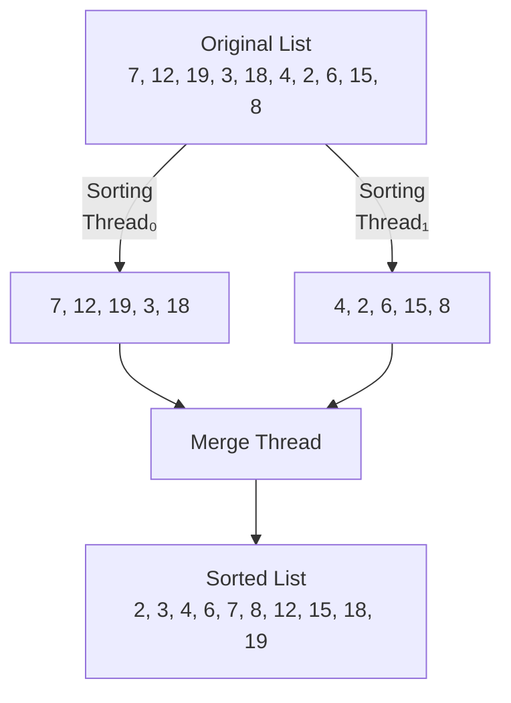

# Lab02: Multithreaded programming

Due date
Please refer to the lab assignment requirements.

## Goal

The goal of this project is (1) to obtain a good understanding of multi‑threading, (2) to practice creating threads and coordinate the running of the threads.

## Part I—Sudoku Solution Validator

A Sudoku puzzle uses a 9 × 9 grid in which each column and row, as well as each of the nine 3 × 3 subgrids, must contain all of the digits 1 · · · 9. The following figure presents an example of a valid Sudoku puzzle. This project consists of designing a multithreaded application that determines whether the solution to a Sudoku puzzle is valid.

There are several different ways of multithreading this application. One suggested strategy is to create threads that check the following criteria:

- A thread to check that each column contains the digits 1 through 9
- A thread to check that each row contains the digits 1 through 9
- Nine threads to check that each of the 3 × 3 subgrids contains the digits 1 through 9

| 6   | 2   | 4   | 5   | 3   | 9   | 1   | 8   | 7   |
| --- | --- | --- | --- | --- | --- | --- | --- | --- |
| 5   | 1   | 9   | 7   | 2   | 8   | 6   | 3   | 4   |
| 8   | 3   | 7   | 6   | 1   | 4   | 2   | 9   | 5   |
| 1   | 4   | 3   | 8   | 6   | 5   | 7   | 2   | 9   |
| 9   | 5   | 8   | 2   | 4   | 7   | 3   | 6   | 1   |
| 7   | 6   | 2   | 3   | 9   | 1   | 4   | 5   | 8   |
| 3   | 7   | 1   | 9   | 5   | 6   | 8   | 4   | 2   |
| 4   | 9   | 6   | 1   | 8   | 2   | 5   | 7   | 3   |
| 2   | 8   | 5   | 4   | 7   | 3   | 9   | 1   | 6   |

This would result in a total of eleven separate threads for validating a Sudoku puzzle. However, you are welcome to create even more threads for this project. For example, rather than creating one thread that checks all nine columns, you could create nine separate threads and have each of them check one column.

### Passing Parameters to Each Thread

The parent thread will create the worker threads, passing each worker the location that it must check in the Sudoku grid. This step will require passing several parameters to each thread. The easiest approach is to create a data structure using a `struct`. For example, a structure to pass the row and column where a thread must begin validating would appear as follows:

```c
/* structure for passing data to threads */
typedef struct
{
    int row;
    int column;
} parameters;
```

Both Pthreads and Windows programs will create worker threads using a strategy similar to that shown below:

```c
parameters *data = (parameters *) malloc(sizeof(parameters));
data->row = 1;
data->column = 1;
/* Now create the thread passing it data as a parameter */
```

The data pointer will be passed to either the `pthread_create()` (Pthreads) function or the `CreateThread()` (Windows) function, which in turn will pass it as a parameter to the function that is to run as a separate thread.

### Returning Results to the Parent Thread

Each worker thread is assigned the task of determining the validity of a particular region of the Sudoku puzzle. Once a worker has performed this check, it must pass its results back to the parent. One good way to handle this is to create an array of integer values that is visible to each thread. The ith index in this array corresponds to the ith worker thread. If a worker sets its corresponding value to 1, it is indicating that its region of the Sudoku puzzle is valid. A value of 0 would indicate otherwise. When all worker threads have completed, the parent thread checks each entry in the result array to determine if the Sudoku puzzle is valid.

## Part II—Multithreaded Sorting Application

Write a multithreaded sorting program that works as follows: A list of integers is divided into two smaller lists of equal size. Two separate threads (which we will term sorting threads) sort each sublist using a sorting algorithm of your choice. The two sublists are then merged by a third thread—a merging thread —which merges the two sublists into a single sorted list.



Fig 2. Multithreaded sorting.

Because global data are shared cross all threads, perhaps the easiest way to set up the data is to create a global array. Each sorting thread will work on one half of this array. A second global array of the same size as the unsorted integer array will also be established.
The merging thread will then merge the two sublists into this second array. Graphically, this program is structured according to Figure 2. This programming project will require passing parameters to each of the sorting threads. In particular, it will be necessary to identify the starting index from which each thread is to begin sorting. Refer to the instructions in Project 1 for details on passing parameters to a thread.

The parent thread will output the sorted array once all sorting threads have exited.

## Submission

Your submission should include the code, a readme file briefly describing your design, how to compile/use your code and, and a report which consists of (but not limited to) the following parts:

- Summarize the thread control methods provided by Linux(or Windows, if applied), and describe the usage.
- Your design of the program
- Snapshots of experimental results(statistics) with analysis
- Problems encountered and your solution
- Reference materials
- Your suggestions and comments

## Environment

Linux (recommended, any kernel after 2.6 is fine) and C/C++.

## References

N/A

> 图注文字：
> Original List：7, 12, 19, 3, 18, 4, 2, 6, 15, 8
> Sorting Thread₀：处理子列表 7, 12, 19, 3, 18
> Sorting Thread₁：处理子列表 4, 2, 6, 15, 8
> Merge Thread：合并两个子列表
> Sorted List：2, 3, 4, 6, 7, 8, 12, 15, 18, 19
